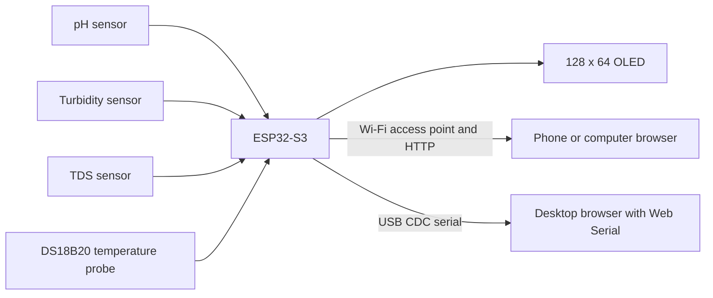
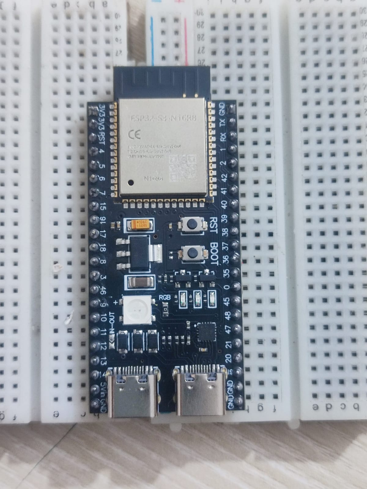
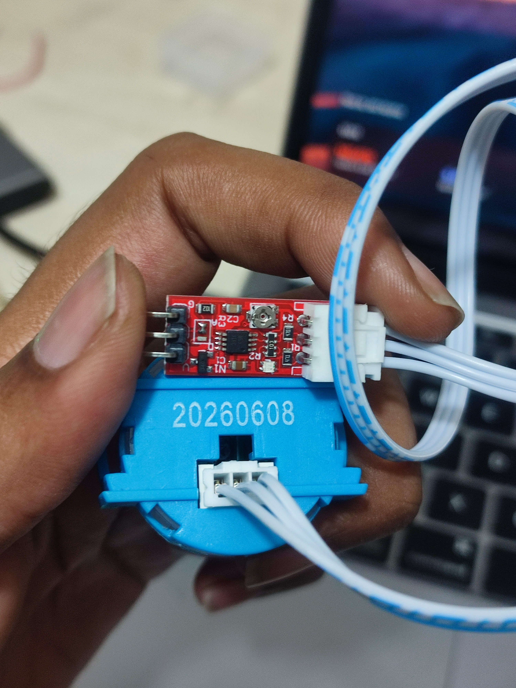
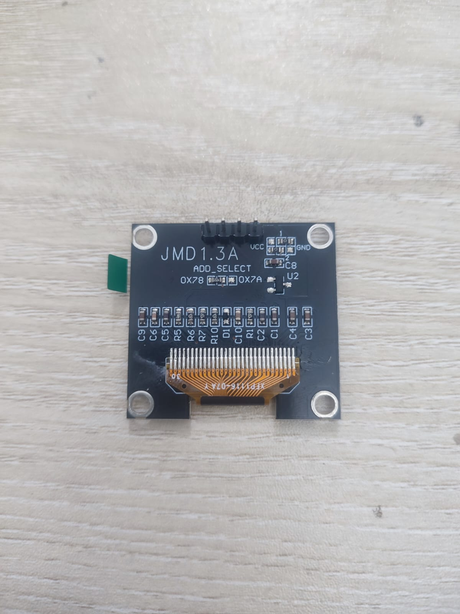
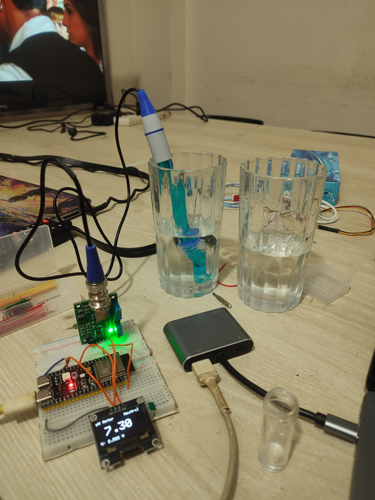

# AQUA MONITOR

**An ESP32-S3 water-quality monitor for aquaculture with a live web dashboard.**

The system reads pH, temperature, total dissolved solids (TDS), and turbidity. View readings on the onboard OLED or in the browser over the ESP32's Wi-Fi hotspot or a USB serial connection.

> **Important:** This project uses low-cost sensors and is intended for educational and indicative field monitoring. Readings are not laboratory-certified and must not be used alone to decide whether water is safe or suitable for a species. Set target ranges for your own species and system, and verify critical measurements with trusted instruments.


## Contents

- [System overview](#system-overview)
- [Hardware and wiring](#hardware-and-wiring)
- [Firmware setup](#firmware-setup)
- [Connect to the dashboard](#connect-to-the-dashboard)
- [Calibration and settings](#calibration-and-settings)
- [HTTP API](#http-api)
- [Repository layout](#repository-layout)
- [Troubleshooting](#troubleshooting)
- [Limitations and safety](#limitations-and-safety)

## System overview

The ESP32-S3 samples the sensors, applies calibration, and serves the dashboard locally. The dashboard can connect either to the ESP32 access point or directly to the board's USB serial port.



The Wi-Fi access point is `AquaMonitor` at `192.168.4.1`; it does not provide internet access. USB dashboard mode uses the standalone `index.html` served from `localhost`.

## Hardware and wiring

| Component | ESP32-S3 connection |
|---|---:|
| OLED SDA | GPIO 8 |
| OLED SCL | GPIO 9 |
| pH sensor analog output | GPIO 4 |
| Turbidity sensor analog output | GPIO 5 |
| TDS sensor analog output | GPIO 6 |
| DS18B20 data | GPIO 7 |

Use a **4.7 kΩ pull-up resistor** between the DS18B20 data line and its supply. The OLED uses I²C address `0x3C`. Confirm the pinout and voltage requirements of your particular ESP32-S3 board and sensor modules before wiring; analog inputs must remain within the board's supported range.






The 3D enclosure files are in [`docs/assets/models/`](docs/assets/models/).

## Firmware setup

### Requirements

- Arduino IDE
- Espressif ESP32 board package **3.0.0 or newer**
- Libraries installed through Arduino Library Manager:
  - Adafruit GFX Library
  - Adafruit SH110X
  - OneWire
  - DallasTemperature

`Wire`, `WiFi`, `WebServer`, and `Preferences` are provided by the ESP32 Arduino core.

### Build and upload

1. Open `WaterQualityMonitor.ino` from this repository in Arduino IDE. Keep `web_ui.h` beside the sketch; the firmware includes it directly.
2. Select **ESP32S3 Dev Module** and configure:

   | Arduino IDE setting | Value |
   |---|---|
   | USB CDC On Boot | **Enabled** (required for USB dashboard mode) |
   | USB Mode | Hardware CDC and JTAG |
   | Flash size / partition | Match your module; 4 MB with the default partition is suitable |
   | Upload speed | 921600; reduce to 115200 if uploads fail |
   | Serial Monitor | 115200 baud |

3. Connect the sensors using the pin table above, then upload the sketch.

The serial monitor displays machine-protocol records such as `DATA:` and `LOG:`; this is expected. Close the serial monitor before connecting to the board from a browser over USB because only one application can open the port at a time.

### Updating the dashboard files

`index.html` is the standalone dashboard, and `web_ui.h` embeds the same page in the firmware. Edit `index.html`, then regenerate the header from the repository root:

```bash
python3 make_web_ui.py
```

Commit both files together so Wi-Fi and USB modes continue to use the same dashboard.

## Connect to the dashboard

### Wi-Fi hotspot

1. Power on the ESP32-S3 and connect your phone or computer to **`AquaMonitor`**.
2. Enter the default password **`Aqua12345`**.
3. Open **http://192.168.4.1** in a browser.

The dashboard should start receiving readings automatically. The access point supports up to six clients. Because it has no internet connection, a phone may ask whether to remain connected or switch to mobile data; choose to stay connected. Use `http://`, not `https://`.

### USB serial

USB mode requires a browser that supports Web Serial and a secure origin. Serve the standalone page from your computer:

```bash
python3 -m http.server 5500
```

Run the command in the repository directory, then open **http://localhost:5500** in desktop Chrome or Edge. Select **USB Serial Connection**, choose the ESP32-S3 port, and grant access. Ensure **USB CDC On Boot** is enabled in the firmware build and the Arduino Serial Monitor is closed.

| Browser/device | Wi-Fi mode | USB mode |
|---|---:|---:|
| Desktop Chrome or Edge | Yes | Yes |
| Firefox or Safari | Yes | Not supported |
| Android browser | Yes | Web Serial not supported |
| iPhone/iPad browser | Yes | Web Serial not supported |

### Dashboard features

- **Dashboard:** live sensor readings, trends, and configured-range assessment.
- **Analytics:** live charts with selectable time windows.
- **History:** pause monitoring and export readings as CSV.
- **Calibration:** adjust sensor calibration and restore defaults.
- **Settings:** configure target ranges, warning margin, and sample interval.

History is held only in the open browser tab (up to 5,000 readings); it is not saved by the ESP32 and is lost when the page is reloaded or closed. Export a CSV to retain it.

## Calibration and settings

Calibration and target settings are stored in ESP32 flash and persist across power cycles. The firmware verifies saved values by reading them back. Use the dashboard's **Calibration** and **Settings** views and wait for the reading to stabilize before capturing a calibration point.

Factory calibration starting values:

| Measurement | Default |
|---|---|
| pH slope / voltage at pH 7 | −5.70 pH/V / 2.574 V |
| Turbidity clear-water point | 1.957 V = 0 NTU |
| Turbidity reference point | 0.50 V = 1000 NTU |
| TDS correction factor | 1.0 |
| Temperature offset | 0 °C |

These are starting estimates, not a substitute for calibration with known buffers, standards, or reference instruments. Default assessment ranges are generic placeholders; configure them for your aquatic species and system before interpreting status labels.

## HTTP API

The ESP32 serves the following local endpoints at `http://192.168.4.1`:

| Endpoint | Method | Purpose |
|---|---|---|
| `/api/data` | GET | Latest sensor reading |
| `/api/status` | GET | Firmware, uptime, memory, access point, and hardware status |
| `/api/calibration` | GET | Read calibration and current settings |
| `/api/calibration` | POST | Set calibration values |
| `/api/calibration/ph` | POST | Calculate pH calibration from buffer points |
| `/api/calibration/reset` | POST | Reset calibration values |
| `/api/settings` | GET | Read calibration and current settings |
| `/api/settings` | POST | Update target ranges and sample interval |

The browser dashboard is the recommended client for calibration and settings, as it submits the expected request fields and displays firmware responses.

## Repository layout

```text
.
├── WaterQualityMonitor.ino   # ESP32-S3 firmware
├── web_ui.h                  # Dashboard embedded in firmware
├── index.html                # Standalone dashboard for USB mode
├── make_web_ui.py            # Regenerates web_ui.h from index.html
└── docs/
    └── assets/
        ├── images/            # Hardware and project photos
        ├── models/            # Enclosure CAD and STL exports
        └── video/             # Project demonstration video
```

## Troubleshooting

| Symptom | Checks |
|---|---|
| Board does not appear as a port | Use a data-capable USB cable; try another port; hold BOOT while connecting to enter download mode. |
| Upload fails | Confirm the selected board and port; lower upload speed; hold BOOT as upload begins. |
| No port appears in the browser | Enable **USB CDC On Boot**, re-upload, and close the Arduino Serial Monitor or other serial applications. |
| USB mode is unavailable | Use desktop Chrome or Edge and open the page from `http://localhost`; USB mode is not available from `192.168.4.1` or `file://`. |
| Dashboard does not load | Join the `AquaMonitor` network, use `http://192.168.4.1`, and keep the phone connected to the hotspot. |
| OLED is blank | Check SDA GPIO 8, SCL GPIO 9, and I²C address `0x3C`. The monitor can continue without the OLED. |
| Temperature shows an error | Check the DS18B20 wiring and 4.7 kΩ pull-up. |
| Analog sensor reports an error | Check sensor wiring and supply; the firmware flags analog voltages outside its 0.05–3.20 V plausibility window. |
| Calibration is not saved | Check the dashboard's save status and restore defaults if needed. |
| History is empty after reopening the page | Browser history is in memory only; export CSV before closing or reloading. |

## Limitations and safety

- Sensor quality, placement, aging, and calibration affect measurement accuracy.
- Status labels compare readings with user-configured ranges; they are not a water-safety determination.
- The default Wi-Fi password is shared in the firmware and documentation. Change `AP_PASS` in `WaterQualityMonitor.ino` before deploying where unauthorized access is a concern.
- The Wi-Fi hotspot is local-only and does not provide cloud access.
- The project has no real-time clock; dashboard timestamps use the browser device's local time.
- Validate the firmware against your selected ESP32 core and hardware before relying on it in an operational aquaculture environment.

## Project photos




[View or download the project demonstration video](docs/assets/video/project-demo.mp4).
